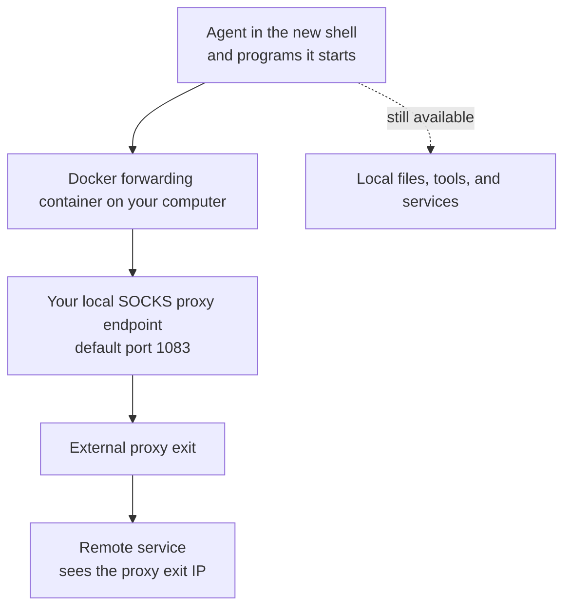

# Agent Network Sandbox (SOCKS Edition)

[繁體中文](README.md) | [简体中文](README.zh-CN.md) | [English](README.en.md)

Route an AI agent's connections through a proxy you choose, reducing the chance of exposing your real public IP when the agent connects to services or sends usage information. When a connection follows the proxy path, the remote service sees the proxy's public IP.

This edition requires an existing SOCKS5 proxy. The scripts send the agent's connections to that proxy while keeping access to your local files, development tools, and services.

The goal is to expose fewer obvious proxy settings and TUN interfaces to routine telemetry, reducing the chance of the network being flagged as unusual. The maintainer reports several months of testing and stable everyday use.

## Why use this instead of a system-wide TUN or HTTP/HTTPS proxy settings?

**The main benefit is that an agent can connect normally while exposing fewer common proxy clues to routine telemetry.** The operating system and a Docker container handle forwarding; the agent does not need to configure or operate a proxy itself.

The three approaches differ in what the agent can readily see:

- **HTTP/HTTPS proxy settings:** The proxy address often appears in application settings, startup arguments, or environment variables that the agent can read.
- **System-wide TUN:** A visible TUN interface and related routes usually appear on the host computer.
- **This project:** You do not need to give the agent a proxy address. The TUN interface is inside Docker, so listing the host's interfaces does not show that interface. Without the required permissions, the agent also cannot inspect the container through Docker commands or list iptables rules directly.

Applications still open connections to their intended destinations, and the system forwards them in the background. This design aims to reduce false positives from routine telemetry that relies on obvious clues such as proxy settings or a TUN interface.

It also suits cases where only the agent should use a proxy. For example, the agent can download files and run Python programs through the proxy while programs in your other terminals keep their usual network path.

You also spend less time configuring each tool the agent uses. Some tools read `HTTP_PROXY` or `HTTPS_PROXY`, some need their own settings, and some connect directly. Handling this group of programs at the system level reduces the chance of missing a tool.

| What matters | This project | System-wide TUN | HTTP/HTTPS proxy settings |
| --- | --- | --- | --- |
| Visible proxy clues | No proxy variables are required; the TUN is inside the container. Inspecting container settings and firewall rules requires appropriate permissions. | A TUN interface and related routes are usually visible on the host. | The proxy address may appear in settings, startup arguments, or environment variables. |
| Which programs use the proxy | The agent started in the sandbox shell and programs it starts directly. | Usually covers the whole computer; exclusions need additional rules. | Depends on which programs read and honor the settings. |
| Does each tool need proxy support? | Usually no; the system forwards connections. | Usually no; the system forwards connections. | Each program or library needs to support the configuration. |
| Programs started by the agent | Normally inherit the restrictions. | Follow the system-wide rules. | May inherit the settings without actually using them. |
| UDP communication | Supported when the SOCKS proxy and every forwarding step support it. | Depends on the TUN software and proxy service. | Ordinary HTTP/HTTPS proxy settings do not handle UDP. |
| Effect on everyday use | Convenient when only the agent needs a different exit IP. | Browsers, downloads, and other programs may also change their network path. | Can target individual programs, but each one needs checking. |

This project also uses TUN internally; it limits forwarding to a particular group of programs. Some system-wide TUN tools support rules for individual applications, but those rules need separate setup and maintenance. If you want the whole computer to use a proxy, a system-wide TUN is more direct. If you only use one tool with reliable HTTP proxy support, configuring that tool may be simpler.

These benefits assume the agent cannot use sudo, access Docker, or administer the network. A normal account in the `docker` group may still manage containers; see [Docker's permission guidance](https://docs.docker.com/engine/install/linux-postinstall/#manage-docker-as-a-non-root-user). The goal is to reduce routine telemetry false positives. There are still limits against deliberate inspection, and different agents may reach different conclusions.

The scripts do not clear proxy environment variables you already have, so check those separately. For an example of how applications use them, see [curl's proxy environment variables](https://curl.se/libcurl/c/libcurl-env.html).

## What you need

- A Linux computer. The scripts target Ubuntu 20.04; check the requirements below before using another system.
- Docker and Docker Compose, using a conventional Docker installation.
- A normal user account with sudo access, so the scripts can configure networking when needed.
- A working SOCKS5 proxy with UDP forwarding support.

The scripts also need several system networking features. You can check them from your normal account without first learning their internals:

```bash
docker compose version
iptables -V
ip6tables -V
test -f /sys/fs/cgroup/net_cls,net_prio/net_cls.classid && echo "net_cls available"
test -c /dev/net/tun && echo "TUN available"
test -w "/run/user/$(id -u)" && echo "User runtime directory is writable"
```

Both firewall version strings must include `legacy`, and the last three commands should print their availability messages. If they do not, resolve the system requirements before starting the sandbox.

The scripts require the cgroup v1 `net_cls` feature at the exact path checked above. A system that only provides cgroup v2 cannot run this version directly. The scripts do not reconfigure your system to meet these requirements.

You also need Bash, sudo, the Docker CLI, and commands including `ip`, `iptables`, `ip6tables`, `flock`, `nsenter`, and `sysctl`. Tests additionally use curl and Python 3; the simple checks also use `dig` and `ping`.

## Additional privacy: choose your timezone and language

Before use, consider changing the computer's timezone and the language of the account that runs the agent. Even with a different public IP, an agent might report the original timezone and language, giving a remote service clues about your location.

Choose settings that suit your proxy location and intended use. For example:

- **Timezone:** UTC, or a city such as New York or Los Angeles. The United States has multiple timezones, so choose a specific city.
- **Language:** English (United States or United Kingdom), German, French, or another language. Adjust date and number formats as well.

The scripts do not change these settings automatically. The Ubuntu desktop example below uses UTC and English (United States); substitute your preferred choices. **These changes remain after you exit the sandbox. The timezone affects the whole computer; language settings mainly affect the account you are using.**

### 1. Choose and change the timezone

In Ubuntu, open **Settings → Date & Time** and turn off **Automatic Time Zone** so location-based updates do not change it back. Automatic clock synchronization can stay enabled; there is no need to move the clock forward or backward.

For example, to use UTC, run:

```bash
sudo timedatectl set-timezone UTC
timedatectl
```

For New York, replace `UTC` with `America/New_York`; for Los Angeles, use `America/Los_Angeles`. You can list other choices with `timedatectl list-timezones`.

Check that `timedatectl` reports the timezone you chose. Sudo is used here only to change the system timezone. Start the sandbox script and the agent as your normal user afterward.

### 2. Choose and change the account language

1. Open **Settings → Region & Language**. Some Ubuntu versions place this under **System**.
2. Choose a language, such as **English (United States)** or **English (United Kingdom)**. If it is missing, open **Manage Installed Languages** and install the corresponding language packages.
3. Set **Formats** to the corresponding region to adjust date and number formats too.
4. Save, then **log out of Ubuntu and log back in**. Closing a terminal or locking the screen is not enough for every application to pick up the change.

### 3. Check the settings before starting the agent

After logging back in, open a new terminal and run:

```bash
date '+%Z %z'
locale
```

Check that the results match your choices. For example, UTC and English (United States) should show `UTC +0000` and primarily `en_US` language settings. Other choices should show their corresponding values.

If old settings still override your choices, check whether `~/.bashrc` or `~/.profile` explicitly sets a timezone or language. Remove or update those entries, then log in again.

Once the settings are correct, start the sandbox and the agent as described below. These changes reduce direct reporting of your original timezone and language, but do not hide other local information or guarantee that your environment cannot be recognized.

For details, see [Ubuntu's region and language settings](https://help.ubuntu.com/stable/ubuntu-help/prefs-language.html), [changing the Ubuntu language](https://help.ubuntu.com/stable/ubuntu-help/session-language.html), and [timedatectl timezone settings](https://www.freedesktop.org/software/systemd/man/247/timedatectl.html).

## How to use it

Run the following commands from the project directory.

### 1. Prepare your proxy

Start a proxy application that provides a SOCKS5 service on your computer. The default port is `1083`. If your proxy uses a different port, edit [docker-compose.yml](docker-compose.yml):

```yaml
environment:
  - PROXY_PROTOCOL=socks5
  - PROXY_PORT=1083
```

**Make sure your proxy supports UDP forwarding.** Some agents may communicate using UDP-based protocols, and hostname lookups commonly use UDP too. A TCP-only proxy may let ordinary web requests work while other agent features fail or hostname lookups time out. If you use intermediate forwarding tools, the entire path must support UDP; forwarding a TCP port alone is not enough.

The forwarding container must also be able to reach the proxy on your computer. A proxy listening only on `127.0.0.1` is not directly reachable from this container. Allow connections from the Docker network in your proxy application, and use firewall rules to restrict access to the necessary sources.

If your SOCKS proxy is remote, first use a local proxy application or forwarding tool to expose a local proxy port that the container can reach. This version has no option for directly entering a remote proxy address, username, and password.

### 2. Start the forwarding container

```bash
chmod +x entrypoint-gateway.sh proxy_safe_final.sh
sudo docker compose up -d
sudo docker compose ps
sudo docker compose logs --tail=50 tproxy-gateway
```

This container passes the agent's connections to your proxy. Its default name is `tproxy-gateway`.

Sudo here is for managing Docker. **Do not add it to the sandbox script command in the next step.**

### 3. Run the main script as a normal user

**Do not run `proxy_safe_final.sh` from a root account or with sudo.** Otherwise, the new shell and an agent started from it will have root privileges. The agent could then change networking, bypass restrictions, or read more system information to identify the sandbox and the real network.

Run it directly from your normal account:

```bash
./proxy_safe_final.sh
```

The script prompts for your password when it needs administrator access to configure networking. You do not need to put sudo before the command.

It prints startup information, then opens a new shell. **Run your usual agent startup command in that shell.** For example, if your agent is a Python program, run that program there.

Only the agent started there and programs it starts directly receive these restrictions. Agents already running in other terminals are not added automatically. The script also does not currently accept an agent command after its filename.

Using a normal account avoids giving the agent administrator access directly. Do not use sudo to start the agent after entering this shell either.

### 4. Check that connections use the proxy IP

In the new shell, run:

```bash
curl --noproxy '*' -4 --fail --show-error --connect-timeout 5 --max-time 15 https://ifconfig.me
```

This prints the public IP used by that connection. Compare it with your proxy's expected exit IP. **Reaching the website is not enough; the IP must be correct too.**

`--noproxy '*'` temporarily ignores curl's own proxy settings so you can check whether this project's forwarding works.

This version blocks external IPv6, so the following connection should fail:

```bash
curl --noproxy '*' -6 --fail --show-error --connect-timeout 5 --max-time 10 https://ifconfig.me
```

However, it would also fail if your computer had no working IPv6 in the first place. Failure alone does not prove the protection works.

### 5. Exit when finished

In the sandbox shell, enter:

```bash
exit
```

The script cleans up networking and stops programs still in that environment. **Background jobs started there are stopped too.**

Back in the outer terminal, check for remaining session state with:

```bash
./proxy_safe_final.sh --status
```

This displays state; it does not test proxy connectivity. Some output may include other users' network rules.

When all agents are finished, you can also stop the forwarding container:

```bash
sudo docker compose stop
```

Stopping it disconnects agents still using it. To run multiple agents, open several terminals and start the main script separately in each. They share one proxy exit; each does not receive a separate public IP.

## How it works

### Connection diagram



The script lets the system track programs started in this shell and sends their external IPv4 connections into the forwarding container. The container runs tun2socks, which passes the connections to your SOCKS proxy and out through its exit.

Normally, the agent needs no separate proxy settings because forwarding happens at the system level. Programs already running in other terminals do not automatically switch to the proxy when you start the sandbox.

The script also handles the following:

- **Redirect common hostname lookups.** DNS translates website names into IP addresses. Ordinary DNS queries sent directly by the agent are redirected to `1.1.1.1` through the same proxy path.
- **Block external IPv6.** This helps prevent the agent from using the computer's original IPv6 connection while IPv4 goes through the proxy.
- **Restrict local network access.** Selected private address ranges are blocked, while local services and the forwarding container remain reachable for development.
- **Check outgoing connections.** While the restrictions are active, traffic intended for the forwarding container is dropped if it leaves through another interface. Exit-time cleanup and other limitations are covered in the known issues below.
- **Clean up on exit.** A background process checks whether you have exited, then removes settings and stops remaining programs.

## Limitations

### Local files and tools remain accessible

The agent still runs on your computer. It can read local files, inspect some network information, and use tools its account is allowed to use. This project does not separately limit file access, memory use, or which programs can be launched.

Even under a normal account, an agent that can use sudo, manage Docker, or ask another local service to act for it may bypass restrictions. If work is handed to a service that is already running, do not assume that service's connections are covered too.

### Manage what the agent uploads separately

Some agents automatically send usage or device information, commonly called telemetry. This project changes where those connections go out; it does not remove their contents.

If an agent uploads an account identifier, device ID, hostname, timezone, file contents, or local IP, a remote service may still recognize your environment. Check the agent's own privacy and telemetry settings separately.

Your proxy provider may also observe or record connections. SOCKS itself does not encrypt all traffic; encryption depends on the agent's connection protocol and the proxy service.

### UDP, DNS, and IPv6 have requirements

- **Your proxy needs UDP forwarding.** Agent features using UDP may fail if the proxy or an intermediate tool does not support it. Successful ordinary web requests do not prove UDP works.
- **Hostname lookups can be affected too.** The script does not automatically convert UDP queries to TCP, so it cannot compensate for missing UDP support.
- **Ordinary DNS is fixed to `1.1.1.1`.** Internal company websites or other services requiring a private DNS server may stop working.
- **Not every lookup method is redirected.** Only TCP/UDP queries sent directly by the agent to IPv4 port `53` are rewritten. Lookups over HTTPS, TLS, or another local service need separate checking.
- **External IPv6 is blocked.** IPv6-only services cannot be reached through this version. Local IPv6 loopback at `::1` is retained.
- **Some network tools are unsuitable as connectivity checks.** For example, a proxy may not support the protocol used by ping. Failed pings do not necessarily mean ordinary agent connections will fail.

### Local network restrictions have exceptions

Selected private address ranges are blocked, but services on your own computer and the forwarding container remain accessible. A local service capable of forwarding connections may still let the agent reach other destinations.

<details>
<summary>Blocked address ranges</summary>

- `10.0.0.0/8`
- `172.16.0.0/12`
- `192.168.0.0/16`
- `169.254.0.0/16`
- `100.64.0.0/10`

Your computer and the forwarding container have exceptions, so this list does not mean all local services are blocked.

</details>

## Known issues

The items below include operating precautions and risks inferred from reading the code that need checking in your environment. They do not mean these failures were reproduced during the maintainer's months of everyday use, but their possible effects still matter.

| Issue | What it means for you |
| --- | --- |
| Use `--cleanup` with care | It stops all sandboxes started by the current account, including active ones. It may also delete unrelated network settings and disrupt a VPN or other networking. |
| Connections may go direct briefly during exit | Cleanup removes restrictions before stopping remaining programs. An agent or another program still running may connect directly during that short interval. |
| Failed setup may leave settings behind | Some cleanup commands lack administrator privileges and may leave firewall rules in place. Check for leftovers after a startup failure. |
| One setting is not restored | The script changes the host's `route_localnet` setting and does not restore its previous value on exit. |
| Startup messages do not prove connectivity | The script does not confirm that the proxy is usable or that the cleanup process started successfully. Check the exit IP and inspect state after exiting. |
| Different accounts may conflict | Allocation is coordinated within one account, but different accounts do not share that protection. |
| The number of simultaneous sessions is limited | The scripts use system rule priorities `100–199`; positions already used by other software reduce availability. |
| The container should have only one Docker network | Reading its address does not properly handle attachment to multiple Docker networks. |
| Existing firewall settings may interact | Some allow rules are placed before existing rules. The container also does not fully block every unlisted connection. Check actual behavior if strict outbound control is required. |
| Exit checks are limited | The scripts check the outgoing Docker network interface, without verifying each connection subsequently uses the intended container and proxy. |
| The socat installation command does not run | The Compose command intended to install socat is not executed, and the forwarding path does not use it. It does not automatically bridge a remote proxy to the host. |
| Full tests can affect networking | They call `--cleanup` with the issues above. Cleanup also runs as root and may miss sandboxes created by a normal account while still affecting other settings. |

## Testing

### Check script syntax only

These commands do not start the sandbox, change firewall rules, or stop containers:

```bash
bash -n proxy_safe_final.sh
bash -n test_proxy_safe.sh
bash -n sandbox_test.sh
sh -n entrypoint-gateway.sh
bash ./test_proxy_safe.sh --self-test
```

`--self-test` only checks whether the test tool can parse startup information. **It does not prove proxy connectivity or leak protection.**

### Simple checks inside the sandbox

Start the sandbox as described above, then run inside it:

```bash
bash ./sandbox_test.sh
```

It checks internet access, local services, private network restrictions, and whether programs started by the agent remain covered.

Before using it, update two values in the test script for your computer:

- `PHYSICAL_IF`: Your actual internet-facing interface; the current value is `enp39s0`.
- `LAN_GATEWAY`: Your local router's address; the current value is `192.168.1.1`.

Some checks report success whenever a connection fails, but that could also mean an unreachable test address, a missing tool, or insufficient permissions. Do not rely on PASS alone; check that the addresses and settings suit your computer.

### Full tests: use a machine where network interruption is acceptable

Full tests start real sandboxes, connect to external sites, and run cleanup. **The cleanup issues above apply even without `--disruptive`.**

```bash
bash ./test_proxy_safe.sh ./proxy_safe_final.sh --sessions 3
```

To test interrupted forwarding, add `--disruptive`. It temporarily changes test networking and stops and restarts the forwarding container. Other agents sharing that container will also lose connectivity:

```bash
bash ./test_proxy_safe.sh ./proxy_safe_final.sh --sessions 3 --disruptive
```

The output shows the report directory, normally under the system temporary directory with a name starting with `proxy-safe-test-`. It contains execution logs and `summary.json`.

Full tests also have two limitations: unanswered UDP queries may produce only a warning, and permission checks use another low-privilege account rather than the actual agent account. A summary with no FAIL results does not prove every protection works.

## FAQ

**The container is running, but the agent cannot get online.**

First check that the proxy itself works, the port is correct, and connections from Docker are allowed. A proxy listening only on `127.0.0.1` is not directly reachable from this container. If only hostname-based connections fail, check DNS and UDP forwarding.

Inspect container errors with:

```bash
sudo docker compose logs --tail=50 tproxy-gateway
```

For further checking, these commands show the host address used by the container, whether its forwarding interface exists, and its routes:

```bash
sudo docker exec tproxy-gateway getent hosts host.docker.internal
sudo docker exec tproxy-gateway ip link show tun0
sudo docker exec tproxy-gateway ip route
```

Seeing `tun0` or `gateway ready` still requires a real connection test to confirm the proxy works. A plain `ip route get` query does not by itself show the agent's actual exit path.

**Is it normal for the agent to see local IP addresses?**

Yes. It still runs on your computer and can read some local information. The script changes outgoing connections, without hiding every local detail. A remote service may learn those details if the agent uploads them.

**Can I run `--cleanup` immediately if something remains after exit?**

Check with `./proxy_safe_final.sh --status` first. Current cleanup can affect unrelated networking and stop other sandboxes under the same account. If you have a VPN or other important network services, do not treat it as a routine cleanup button.

## Project files and other settings

| File | Purpose |
| --- | --- |
| [docker-compose.yml](docker-compose.yml) | Configures the forwarding container and the proxy port it connects to. |
| [entrypoint-gateway.sh](entrypoint-gateway.sh) | Prepares forwarding when the container starts. |
| [proxy_safe_final.sh](proxy_safe_final.sh) | The main script used to open the sandbox. |
| [sandbox_test.sh](sandbox_test.sh) | Runs simple checks inside the sandbox. |
| [test_proxy_safe.sh](test_proxy_safe.sh) | Runs full tests, which may affect host networking. |

For normal use, set `PROXY_PORT` to your proxy's port and keep `PROXY_PROTOCOL=socks5`. After changing them, run `sudo docker compose up -d` again to apply the container configuration.

If you rename the container, set `GATEWAY_CONTAINER` to the same name when starting the main script. The container reaches your computer through `host.docker.internal`; this name is configured by Docker and is not an option for entering a remote proxy address.

The main script also has `--help` and `--status` options. The DNS destination `1.1.1.1` and the system feature path mentioned above are currently fixed in the code, without separate configuration options.
