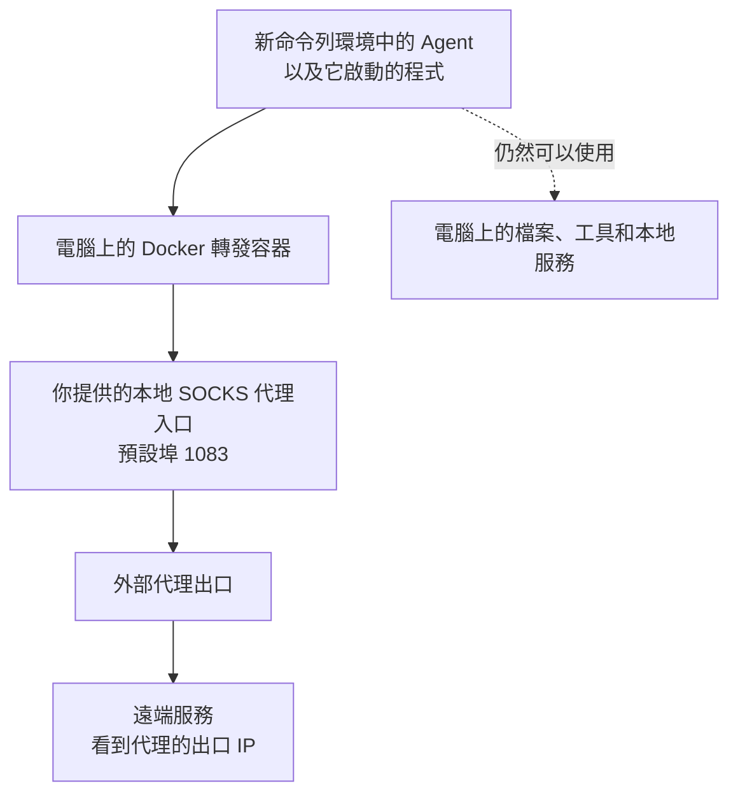

# Agent 網絡沙盒（SOCKS 簡易版）

[繁體中文](README.md) | [简体中文](README.zh-CN.md) | [English](README.en.md)

讓 Agent 智能體透過你指定的代理上網，減少它在連線或自動回傳使用資訊時，暴露你真實公網 IP 的機會。正常經由代理連線時，遠端服務看到的是代理的出口 IP。

這個版本需要你自行準備 SOCKS5 代理。腳本負責把 Agent 的網絡連線送到代理，你仍然可以讓 Agent 使用電腦上的檔案、開發工具和本地服務。

這個專案的重點，是減少一般遙測容易看到的代理設定與 TUN 網卡線索，降低網絡環境被誤判為異常的機會。維護者已測試使用數月，日常運行穩定。

## 為什麼用這種方式，而不是全局 TUN 或 HTTP／HTTPS 代理

**主要優勢是：Agent 可以照平時的方式連線，少暴露一些常見的代理線索，減少一般遙測誤判的機會。** 實際轉發由系統和 Docker 容器處理，Agent 不需要自己設定或操作代理。

三種方式的差別，主要在於 Agent 平常能直接看到什麼：

- **HTTP／HTTPS 代理**：代理地址常出現在程式設定、啟動參數或環境變數中，容易被直接讀到。
- **全局 TUN**：通常會在電腦上出現可查看的 TUN 網卡和相關路由，留下比較明顯的虛擬網卡線索。
- **本專案**：不需要替 Agent 填入代理地址，TUN 也放在 Docker 容器內。Agent 直接查看本機網卡時，看不到容器裡的那張 TUN 網卡；沒有相應權限時，也不能透過 Docker 命令查看容器內部設定，或直接讀取 iptables 規則。

對正常發起連線的程式而言，仍然是直接連向目標網站，由系統在背後代為轉發。這個設計希望減少一般遙測僅憑代理設定或 TUN 網卡等明顯線索，就把環境判定為異常的情況。

如果你只想讓 Agent 走代理，同時保留其他程式原本的上網方式，這個方案比較適合。例如，Agent 在下載檔案、執行 Python 程式時走代理，你在其他終端運行的程式則不會自動跟著改變出口。

另一個好處是，不必逐一確認 Agent 使用的每個工具是否支援代理。有些工具會讀取 `HTTP_PROXY`、`HTTPS_PROXY` 等設定，有些需要自己設定，有些則會直接連線；本專案從系統這一層處理這組程式的網絡，減少漏設某個工具的情況。

| 比較項目 | 本專案 | 全局 TUN | HTTP／HTTPS 代理設定 |
| --- | --- | --- | --- |
| 容易看到的代理線索 | 不必設定代理變數，TUN 在容器內；查看容器設定和防火牆規則需要相應權限。 | 通常能在電腦上查看到 TUN 網卡和相關路由。 | 代理地址可能出現在程式設定、啟動參數或環境變數中。 |
| 哪些程式會走代理 | 從沙盒命令列啟動的 Agent 與它直接啟動的程式。 | 通常接管整台電腦的連線，要排除其他程式需另設規則。 | 取決於哪些程式讀取並採用了代理設定。 |
| 需要每個工具支援代理嗎 | 一般不需要，由系統轉發。 | 一般不需要，由系統轉發。 | 需要確認每個程式或它使用的工具是否支援。 |
| Agent 再啟動其他程式 | 一般會一起受到限制。 | 按照全局規則處理。 | 即使繼承了代理設定，新程式也未必會使用。 |
| UDP 通信 | 可以轉發，但你的 SOCKS 代理和中間工具必須支援。 | 取決於使用的 TUN 工具與代理服務。 | 一般的 HTTP／HTTPS 代理設定無法處理 UDP。 |
| 對日常使用的影響 | 方便只替 Agent 更換出口。 | 瀏覽器、下載及其他程式也可能一起改變出口。 | 可只設定個別程式，但要逐一確認有沒有漏掉。 |

本專案內部也使用 TUN，差別在於把範圍限定在指定的這組程式。全局 TUN 工具也可能支援按程式分流，但需要另外設定與維護規則。如果你本來就希望整台電腦都走代理，全局 TUN 會更直接；如果只有一個明確支援 HTTP 代理的工具，直接設定該工具也更省事。

上述優勢以 Agent 沒有 sudo、Docker 存取權或網絡管理權限為前提；普通帳戶若已加入 `docker` 群組，仍可能管理容器，詳見 [Docker 的權限說明](https://docs.docker.com/engine/install/linux-postinstall/#manage-docker-as-a-non-root-user)。目標是減少一般遙測誤判，對刻意檢查本機資訊的程式仍有局限，也不能保證所有 Agent 都有相同判斷。

如果你原本就設有代理環境變數，腳本不會自動清除，請另行確認。HTTP 代理設定如何被程式採用，可參考 [curl 的代理環境變數說明](https://curl.se/libcurl/c/libcurl-env.html)。

## 使用前需要準備什麼

- 一台 Linux 電腦。目前腳本以 Ubuntu 20.04 為目標，其他系統需要先確認是否符合下方條件。
- 已安裝 Docker 和 Docker Compose，使用一般的 Docker 安裝方式。
- 一個普通使用者帳戶。這個帳戶需要有 sudo 權限，供腳本設定網絡時使用。
- 一個可用的 SOCKS5 代理，並且支援 UDP 轉發。

此外，腳本需要系統提供幾項網絡功能。你不必先理解它們的原理，可以在普通帳戶的終端中檢查：

```bash
docker compose version
iptables -V
ip6tables -V
test -f /sys/fs/cgroup/net_cls,net_prio/net_cls.classid && echo "net_cls 可用"
test -c /dev/net/tun && echo "TUN 可用"
test -w "/run/user/$(id -u)" && echo "使用者暫存目錄可寫"
```

兩個防火牆版本輸出都必須含有 `legacy`，最後三行也應顯示相應的可用訊息。如果沒有，請先處理系統環境，再執行腳本。

目前需要 cgroup v1 的 `net_cls` 功能，位置必須是上方檢查的路徑。只提供 cgroup v2 的系統無法直接使用，腳本不會自動替你更改系統設定。

系統還需要 Bash、sudo、Docker CLI，以及 `ip`、`iptables`、`ip6tables`、`flock`、`nsenter`、`sysctl` 等命令。測試另需 curl 和 Python 3；簡易測試還會用到 `dig` 和 `ping`。

## 安全加強：修改時區和語言

使用前，建議自行調整電腦的時區，以及執行 Agent 的帳戶所使用的語言。即使已經換了代理 IP，Agent 仍可能讀取原本的時區和語言並上傳，讓遠端拿來推測你的所在地。

你可以按照代理出口所在地與自己的使用需求選擇，例如：

- **時區**：UTC，或美國紐約、洛杉磯等地的時區。美國有多個時區，需要選擇具體城市。
- **語言**：英文（美國或英國），也可以選擇德文、法文等其他語言，並一起調整日期和數字格式。

腳本目前不會自動修改這些設定。下面以 Ubuntu 桌面版的 UTC 和英文（美國）示範操作，你可以換成自己選擇的時區與語言。**這些修改在退出沙盒後仍然保留；時區會影響整台電腦，語言則主要影響你正在使用的帳戶。**

### 1. 選擇並修改時區

先到 Ubuntu 的「設定 → 日期與時間」，關閉「自動時區」，避免系統根據位置把時區改回去。自動校正時間可以保留，不需要把電腦的時間調快或調慢。

例如，想使用 UTC，可以在終端執行：

```bash
sudo timedatectl set-timezone UTC
timedatectl
```

如果想使用美國紐約的時區，將命令中的 `UTC` 換成 `America/New_York`；洛杉磯則使用 `America/Los_Angeles`。也可以用 `timedatectl list-timezones` 查看其他可選時區。

確認 `timedatectl` 輸出的時區與你的選擇一致。這裡的 sudo 只用來修改系統時區，之後啟動主腳本和 Agent 時，仍然要使用普通帳戶。

### 2. 選擇並修改帳戶語言

1. 開啟「設定 → 地區與語言」。部分 Ubuntu 版本需要先進入「系統」分類。
2. 選擇你希望使用的語言，例如 **English (United States)** 或 **English (United Kingdom)**。如果找不到想要的語言，先開啟「管理已安裝的語言」，安裝對應的語言套件。
3. 將「格式」改為對應的地區，讓日期和數字格式一起調整。
4. 儲存後，**登出 Ubuntu 再重新登入**。只關閉終端或鎖定畫面，不足以讓所有程式套用新設定。

### 3. 確認設定，再啟動 Agent

重新登入後，打開新的終端，執行：

```bash
date '+%Z %z'
locale
```

確認結果與你選擇的設定一致。例如，選擇 UTC 和英文（美國）時，時間應顯示 `UTC +0000`，語言設定應以 `en_US` 為主；選擇其他時區或語言時，以相應結果為準。

如果仍被原本的設定覆蓋，請檢查 `~/.bashrc`、`~/.profile` 是否另外指定了時區或語言，將舊設定移除或改成一致，再重新登入。

確認後，再按下方步驟啟動沙盒和 Agent。這些調整能減少原本時區和語言被直接上報，但不會隱藏其他本機資訊，也不保證遠端無法辨認你的環境。

操作細節可參考 [Ubuntu 語言與地區設定](https://help.ubuntu.com/stable/ubuntu-help/prefs-language.html)、[Ubuntu 切換語言說明](https://help.ubuntu.com/stable/ubuntu-help/session-language.html)與 [timedatectl 時區設定說明](https://www.freedesktop.org/software/systemd/man/247/timedatectl.html)。

## 怎麼使用

以下命令都在本專案目錄中執行。

### 1. 準備好你的代理

先讓代理軟件在你的電腦上提供 SOCKS5 服務。腳本預設連到 `1083` 埠；如果你的代理使用其他埠，請修改 [docker-compose.yml](docker-compose.yml) 中的設定：

```yaml
environment:
  - PROXY_PROTOCOL=socks5
  - PROXY_PORT=1083
```

**請確保你的代理支援 UDP 轉發。** 一些 Agent 可能使用基於 UDP 的協議通信，查詢網站地址也常會用到 UDP。如果代理只支援 TCP，可能出現網頁能開，但 Agent 的某些功能無法連線，或網站地址查詢一直超時的情況。如果中間還經過其他轉接工具，整條路徑都需要支援 UDP；只轉接 TCP 埠並不夠。

另外，轉發容器必須能連到電腦上的代理。如果代理只在 `127.0.0.1` 上提供服務，容器就無法直接使用它。請在代理軟件中允許來自 Docker 網絡的連線，並用防火牆限制允許的來源，避免把代理開放給不相關的人使用。

如果你的 SOCKS 代理在遠端，請先讓電腦上的代理軟件或轉接工具連上它，再提供一個容器能使用的本地代理埠。目前這個版本還沒有直接填寫遠端代理地址、帳號與密碼的選項。

### 2. 啟動負責轉發的容器

```bash
chmod +x entrypoint-gateway.sh proxy_safe_final.sh
sudo docker compose up -d
sudo docker compose ps
sudo docker compose logs --tail=50 tproxy-gateway
```

這個容器負責把 Agent 的連線交給你的代理。容器名稱預設是 `tproxy-gateway`。

這裡的 `sudo` 是用來管理 Docker 容器，**不要把它加到下一步的主腳本命令前面。**

### 3. 用普通帳戶執行主腳本

**千萬不要用 root 帳戶，也不要使用 sudo 執行 `proxy_safe_final.sh`。** 否則，腳本新建的命令列環境，以及從中啟動的 Agent，都會取得 root 權限。Agent 就有可能修改網絡設定、繞過限制，或讀取更多系統資訊來識別沙盒和真實網絡。

請直接用普通帳戶執行：

```bash
./proxy_safe_final.sh
```

需要管理員權限設定網絡時，腳本會主動提示你輸入密碼，不需要在命令前加 sudo。

腳本會顯示一些啟動資訊，然後帶你進入新的命令列環境。接下來，**就在這個環境中執行你平時使用的 Agent 啟動命令**。例如，你的 Agent 是一個 Python 程式，就在這裡執行它。

從這裡啟動的 Agent，以及它直接啟動的其他程式，才會套用這組網絡限制。已經在其他終端運行的 Agent 不會自動受到影響。腳本目前也不支援把 Agent 命令直接接在腳本名稱後面執行。

使用普通帳戶是為了避免直接把管理員權限交給 Agent。進入這個環境後，也不要再用 sudo 啟動 Agent。

### 4. 確認連出去的是代理 IP

在剛才的新命令列環境中執行：

```bash
curl --noproxy '*' -4 --fail --show-error --connect-timeout 5 --max-time 15 https://ifconfig.me
```

它會顯示這次連線的公網 IP。請確認結果與你的代理出口一致。**能連上網站還不夠，出口 IP 也必須正確。**

命令中的 `--noproxy '*'` 是為了暫時忽略 curl 自己的代理設定，確認這個腳本能否把連線送到代理。

目前不支援經由這個沙盒使用外部 IPv6，所以下面的連線預期會失敗：

```bash
curl --noproxy '*' -6 --fail --show-error --connect-timeout 5 --max-time 10 https://ifconfig.me
```

不過，如果你的電腦原本就沒有 IPv6，這條命令一樣會失敗。因此，單看失敗結果，不能證明防護一定正常。

### 5. 用完後退出

在沙盒的命令列環境中輸入：

```bash
exit
```

腳本會在你退出後清理網絡設定，並關閉還留在裡面的程式。**你從裡面啟動的背景任務，也會一起被關閉。**

回到外面的終端後，可以查看是否還有留下的執行記錄：

```bash
./proxy_safe_final.sh --status
```

這個命令用來查看狀態，不會替你測試代理是否能連線；部分輸出也可能包含其他人的網絡規則。

如果所有 Agent 都已經用完，也可以停止轉發容器：

```bash
sudo docker compose stop
```

停止容器會讓仍在使用它的 Agent 斷網。要同時使用多個 Agent，可以開幾個終端，分別執行主腳本；它們仍然共用同一個代理出口，不會各自取得不同的公網 IP。

## 它是怎麼工作的

### 原理圖



腳本會讓系統記住「哪些程式是從這個命令列環境啟動的」，再把這些程式的外部 IPv4 連線送進 Docker 轉發容器。容器使用 tun2socks，把連線交給你提供的 SOCKS 代理，最後從代理出口連到遠端服務。

一般情況下，Agent 不需要另外設定代理；腳本在系統這一層處理連線。其他終端原本運行的普通程式，則不會因為你開啟這個沙盒就自動改用代理。

腳本還會處理幾件事：

- **統一常見的網站地址查詢。** DNS 是把網站名稱查成 IP 地址的服務。這裡會把 Agent 直接發出的普通 DNS 查詢改送到 `1.1.1.1`，再經由同一條代理路徑送出。
- **阻擋外部 IPv6。** 避免 Agent 在 IPv4 走代理的同時，又透過電腦原本的 IPv6 直接連線。
- **限制內網存取。** 阻擋指定的內網地址，但保留你電腦上的本地服務和轉發容器，方便開發。
- **檢查連線出口。** 限制正常生效時，應該走轉發容器的連線如果改從其他網卡送出，就會被擋下。目前退出清理等情況仍有例外，詳見後面的已知問題。
- **退出後收尾。** 一個背景清理程式會檢查你是否退出；退出後，它會移除設定並關閉殘留程式。

## 哪些事情它做不到

### 仍然保留本機檔案與工具的使用權限

Agent 仍然在你的電腦上運行，可以讀取本機檔案、查看部分網絡資訊，以及使用原本有權使用的工具。這個專案沒有另外限制它能讀哪些檔案、能用多少記憶體，或能啟動哪些程式。

即使你用普通帳戶啟動，如果 Agent 仍能自行使用 sudo、管理 Docker，或透過其他本地服務替它做事，也可能繞過限制。把工作交給另一個已經在運行的服務後，不能假設那個服務的網絡也會一起受管。

### Agent 上傳了什麼，仍要另外管理

有些 Agent 會自動回傳使用情況或裝置資訊，這通常叫做遙測。本專案只改變這些連線從哪裡出去，不會刪掉它上傳的內容。

如果 Agent 上傳帳號、裝置編號、主機名稱、時區、檔案內容或本機 IP，遠端仍然可能據此辨認你的環境。請另外檢查 Agent 自己的隱私與遙測設定。

代理服務提供者也可能看到或記錄連線。SOCKS 本身不會替所有資料加密，資料是否加密，仍取決於 Agent 使用的連線方式與代理方案。

### UDP、DNS 和 IPv6 都有使用條件

- **代理需要支援 UDP 轉發。** 如果 Agent 要使用 UDP，但代理或中間的轉接工具不支援，相關功能就可能失敗。一般網頁連線成功，不代表 UDP 也能用。
- **網站地址查詢也可能受影響。** 腳本不會自動把 UDP 查詢改成 TCP；代理不支援 UDP 時，不能指望它自動補救。
- **普通 DNS 固定使用 `1.1.1.1`。** 公司內部網站等依賴專用 DNS 的服務，可能因此無法使用。
- **不是所有查詢方式都會被改寫。** 目前只處理 Agent 直接送往 IPv4 埠 `53` 的 TCP／UDP 查詢；透過 HTTPS、TLS 或本機其他服務查詢的情況，需要另外確認。
- **外部 IPv6 目前被禁用。** 如果某個服務只支援 IPv6，就不能透過目前版本連線。電腦內部的 IPv6 地址 `::1` 仍然保留。
- **不是所有網絡工具都適合拿來測試。** 例如 ping 使用的通信方式不一定受代理支援，ping 不通不代表 Agent 的普通連線一定不能用。

### 內網限制仍有例外

腳本會阻擋指定的內網地址，但你電腦自己的服務和轉發容器仍然可以存取。如果本機某個服務能替 Agent 轉發連線，Agent 仍有機會透過它連往其他地方。

<details>
<summary>被阻擋的地址範圍</summary>

- `10.0.0.0/8`
- `172.16.0.0/12`
- `192.168.0.0/16`
- `169.254.0.0/16`
- `100.64.0.0/10`

電腦本機與轉發容器有例外，因此這份清單不代表能阻擋所有本機服務。

</details>

## 目前已知的問題

以下列出操作上的注意事項，以及根據程式閱讀推斷、需要配合實際環境確認的風險。這些內容不代表已在維護者數月的日常使用中重現故障；使用前仍應了解相關影響。

| 問題 | 對你有什麼影響 |
| --- | --- |
| 不要隨便使用 `--cleanup` | 它會關閉目前帳戶啟動的所有沙盒，包括還在使用的。現在還可能誤刪其他程式的網絡設定，導致 VPN 或其他網絡功能失效。 |
| 退出時可能短暫直接上網 | 自動清理會先解除網絡限制，再關閉殘留程式。仍在運行的 Agent 或其他程式，可能在這個短暫空檔直接連線。 |
| 啟動失敗可能沒有清乾淨 | 某些清理步驟缺少管理員權限，可能留下網絡規則；看到啟動失敗後，要檢查是否還有殘留。 |
| 關閉後有設定沒有還原 | 腳本改動的一項本機網絡設定 `route_localnet`，退出後不會自動恢復原值。 |
| 顯示啟動資訊不代表能上網 | 腳本沒有確認代理是否真的可用，也沒有確認背景清理程式是否已正常啟動。請實際檢查出口，退出後再查看狀態。 |
| 不同帳戶同時啟動可能衝突 | 同一帳戶有防止同時搶用設定的處理，但不同帳戶之間沒有共用這個保護。 |
| 同時開啟的數量有限 | 腳本共用系統中編號 `100–199` 的網絡規則位置，其他程式已佔用的位置也會減少可用數量。 |
| 轉發容器目前只能接一個 Docker 網絡 | 腳本讀取容器地址的方式，還沒有妥善處理同時接上多個 Docker 網絡的情況。 |
| 可能與原有防火牆設定互相影響 | 腳本的部分放行設定會排在原有規則之前；容器中也沒有完整封鎖所有未列出的連線。需要嚴格限制出網時，應另外確認實際效果。 |
| 檢查出口還不夠嚴格 | 目前只檢查連線是否送到指定的 Docker 網絡，沒有逐一確認後續一定經過指定容器和代理。 |
| 設定檔中的 socat 安裝沒有執行 | Compose 裡「先安裝 socat」的命令目前不會生效，轉發流程也沒有使用它。它不會自動替你把遠端代理接到本機。 |
| 完整測試也會影響網絡 | 測試會呼叫有上述問題的 `--cleanup`，而且清理時使用 root 身份，可能找不到普通帳戶啟動的沙盒，卻仍影響其他網絡設定。 |

## 怎麼測試

### 只檢查腳本格式

下面這組命令不會啟動沙盒、修改防火牆或停止容器：

```bash
bash -n proxy_safe_final.sh
bash -n test_proxy_safe.sh
bash -n sandbox_test.sh
sh -n entrypoint-gateway.sh
bash ./test_proxy_safe.sh --self-test
```

這裡的 `--self-test` 只確認測試工具能讀懂啟動資訊，**不代表代理連通或防洩漏測試通過。**

### 在沙盒裡做簡單檢查

先按前面的步驟啟動沙盒，再在裡面執行：

```bash
bash ./sandbox_test.sh
```

它會檢查上網、本機服務、內網限制，以及 Agent 啟動其他程式後是否仍然受限。

使用前，請按你的電腦修改測試腳本中的兩項設定：

- `PHYSICAL_IF`：實際用來上網的網卡名稱，目前寫的是 `enp39s0`。
- `LAN_GATEWAY`：你的局域網路由器地址，目前寫的是 `192.168.1.1`。

某些測試只要連線失敗就會顯示通過，但也可能是測試地址本來就連不上、工具沒有安裝，或權限不足。請不要只看 PASS，還要確認測試的地址與設定真的適用於你的電腦。

### 完整測試：請在可以中斷網絡的測試機上執行

完整測試會真的啟動多個沙盒、連線到外部網站，並執行清理。**即使沒有加 `--disruptive`，也會受到前面提到的清理問題影響。**

```bash
bash ./test_proxy_safe.sh ./proxy_safe_final.sh --sessions 3
```

如果要測試「代理通道中斷後會怎樣」，可以加上 `--disruptive`。它會暫時改動測試用的網絡設定，並停止、重啟轉發容器，其他正在使用同一容器的 Agent 也會斷網：

```bash
bash ./test_proxy_safe.sh ./proxy_safe_final.sh --sessions 3 --disruptive
```

測試結果會印出報告所在的目錄，通常在系統暫存目錄中，名稱以 `proxy-safe-test-` 開頭。裡面會有執行記錄和 `summary.json`。

完整測試也有兩個限制：UDP 沒有回應時，可能只記錄警告；權限測試使用的是另一個低權限帳戶，不能代表實際 Agent 帳戶沒有提權能力。因此，沒有 FAIL 不等於所有保護都已確認有效。

## 常見問題

**容器已啟動，但 Agent 不能上網？**

先檢查代理本身能否使用、埠號是否正確，以及是否允許來自 Docker 的連線。如果代理只開在 `127.0.0.1`，容器無法直接使用它。如果只有網站名稱連不上，則要檢查網站地址查詢和 UDP 轉發。

可以先查看轉發容器的錯誤訊息：

```bash
sudo docker compose logs --tail=50 tproxy-gateway
```

若需要進一步檢查，下面三條命令分別查看容器使用哪個地址連回你的電腦、轉發用的網絡裝置是否存在，以及目前怎麼送出連線：

```bash
sudo docker exec tproxy-gateway getent hosts host.docker.internal
sudo docker exec tproxy-gateway ip link show tun0
sudo docker exec tproxy-gateway ip route
```

看到 `tun0` 或日誌中的 `gateway ready`，仍需要實際測試才能確定代理可以連線。單獨執行 `ip route get`，也不能直接看出 Agent 真正使用的出口。

**Agent 仍能看到本機 IP，這正常嗎？**

正常。它仍然在你的電腦上運行，所以能讀取部分本機資訊。這個腳本改變的是連出去的路徑，不會替你隱藏所有本機資料。如果 Agent 把這些資料上傳，遠端仍可能得知。

**退出後有殘留，能直接執行 `--cleanup` 嗎？**

先用 `./proxy_safe_final.sh --status` 查看。目前 `--cleanup` 可能誤動其他程式的網絡設定，也會關閉同一帳戶的其他沙盒；有 VPN 或其他重要網絡服務時，請不要把它當作一般的清理按鈕直接使用。

## 專案文件與其他設定

| 文件 | 用途 |
| --- | --- |
| [docker-compose.yml](docker-compose.yml) | 設定轉發容器，以及它要連到哪個代理埠。 |
| [entrypoint-gateway.sh](entrypoint-gateway.sh) | 容器啟動時執行，負責準備轉發環境。 |
| [proxy_safe_final.sh](proxy_safe_final.sh) | 你平時用來開啟沙盒的主腳本。 |
| [sandbox_test.sh](sandbox_test.sh) | 在沙盒內做簡單檢查。 |
| [test_proxy_safe.sh](test_proxy_safe.sh) | 執行完整測試，可能影響本機網絡。 |

一般使用時，只需要按代理的實際埠號修改 `PROXY_PORT`，並保留 `PROXY_PROTOCOL=socks5`。修改後重新執行 `sudo docker compose up -d`，讓容器套用新設定。

若你改了容器名稱，啟動主腳本時也要用 `GATEWAY_CONTAINER` 指定同一個名稱。容器透過 `host.docker.internal` 連回你的電腦；這個名稱由 Docker 設定，不能拿來直接填寫遠端代理。

主腳本另有 `--help` 和 `--status` 選項。網站地址查詢使用的 `1.1.1.1`，以及前面提到的系統功能路徑，目前都寫在程式裡，沒有另外提供設定選項。
