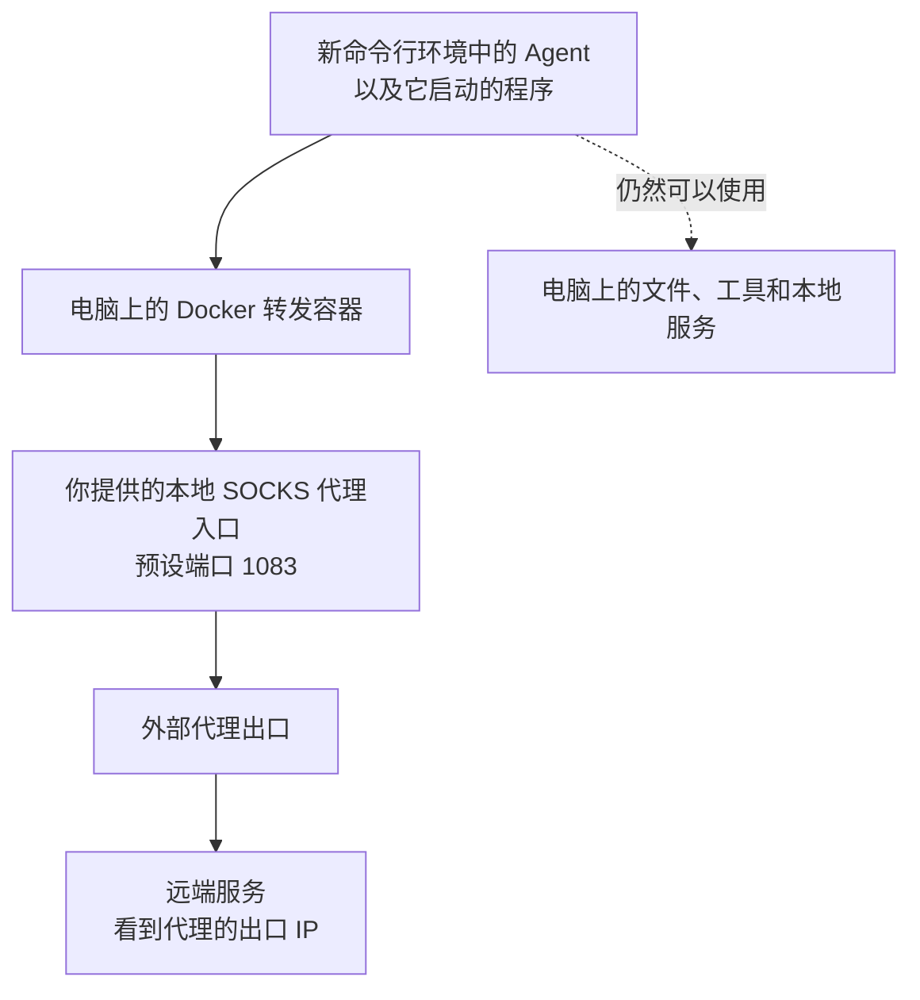

# Agent 网络沙盒（SOCKS 简易版）

[繁體中文](README.md) | [简体中文](README.zh-CN.md) | [English](README.en.md)

让 Agent 智能体通过你指定的代理上网，减少它在连接或自动上报使用信息时，暴露你真实公网 IP 的机会。正常经由代理连接时，远端服务看到的是代理的出口 IP。

这个版本需要你自行准备 SOCKS5 代理。脚本负责把 Agent 的网络连接送到代理，你仍然可以让 Agent 使用电脑上的文件、开发工具和本地服务。

这个项目的重点，是减少一般遥测容易看到的代理设置与 TUN 网卡线索，降低网络环境被误判为异常的机会。维护者已使用本方案运行 Claude Code 数月，日常运行稳定。

## 为什么用这种方式，而不是全局 TUN 或 HTTP／HTTPS 代理

**两个重点是：故障时阻止直连，以及减少明显的代理线索。** 实际转发由系统和 Docker 容器处理，Agent 可以照平时的方式连接，不需要自己设置或操作代理。

**代理或网络故障时，宁可断网，也不绕过代理改用真实出口，这就是 fail-closed。** 对沙盒里的 Agent 或其他程序来说，代理不可用时应该是连接失败、逾时或中断，而不是悄悄用电脑原本的公网 IP 继续上网。

这是与只接管路由、没有正确设置断线保护的全局 TUN 方案相比，一个关键差别。有些 TUN 工具在断线、退出或重新连接时会恢复原路由，这段期间的流量可能直接送出；“会自动重连”本身并不能保证重连期间不直连。具备正确断线保护的 TUN 工具也能做到 fail-closed，仍需核对具体设置。

**本简易版的防直连规则在会话运行期间生效。退出时，请先关闭 Agent 或应用程序，再退出 Shell。** 其他环境条件和操作方法见“使用注意事项与处理方式”。

三种方式的差别，主要在于 Agent 平常能直接看到什么：

- **HTTP／HTTPS 代理**：代理地址常出现在程序设置、启动参数或环境变量中，容易被直接读到。
- **全局 TUN**：通常会在电脑上出现可查看的 TUN 网卡和相关路由，留下比较明显的虚拟网卡线索。
- **本项目**：不需要替 Agent 填入代理地址，TUN 也放在 Docker 容器内。Agent 直接查看本机网卡时，看不到容器里的那张 TUN 网卡；没有相应权限时，也不能通过 Docker 命令查看容器内部设置，或直接读取 iptables 规则。

对正常发起连接的程序而言，仍然是指定目标网站，由系统在背后代为转发。程序的使用方式像直连，实际对外公网出口仍然是代理。这个设计希望减少一般遥测仅凭代理设置或 TUN 网卡等明显线索，就把环境判定为异常的情况。

如果你只想让 Agent 走代理，同时保留其他程序原本的上网方式，这个方案比较适合。例如，Agent 在下载文件、执行 Python 程序时走代理，你在其他终端运行的程序则不会自动跟着改变出口。

另一个好处是，不必逐一确认 Agent 使用的每个工具是否支持代理。有些工具会读取 `HTTP_PROXY`、`HTTPS_PROXY` 等设置，有些需要自己设置，有些则会直接连接；本项目从系统这一层处理这组程序的网络，减少漏设某个工具的情况。

| 比较项目 | 本项目 | 全局 TUN | HTTP／HTTPS 代理设置 |
| --- | --- | --- | --- |
| 代理或网络故障时 | 运行中的规则阻止流量改走普通出口；退出时先关闭 Agent 或应用程序，再退出 Shell。 | 未设好断线保护时，可能在退出或重连期间回到原路由并直接送出；有正确保护的工具可避免。 | 单靠代理设置不提供系统层的断线保护，是否重试直连取决于程序。 |
| 容易看到的代理线索 | 不必设置代理变量，TUN 在容器内；查看容器设置和防火墙规则需要相应权限。 | 通常能在电脑上查看到 TUN 网卡和相关路由。 | 代理地址可能出现在程序设置、启动参数或环境变量中。 |
| 哪些程序会走代理 | 从沙盒命令行启动的 Agent 与它直接启动的程序。 | 通常接管整台电脑的连接，要排除其他程序需另设规则。 | 取决于哪些程序读取并采用了代理设置。 |
| 需要每个工具支持代理吗 | 一般不需要，由系统转发。 | 一般不需要，由系统转发。 | 需要确认每个程序或它使用的工具是否支持。 |
| Agent 再启动其他程序 | 一般会一起受到限制。 | 按照全局规则处理。 | 即使继承了代理设置，新程序也未必会使用。 |
| UDP 通信 | 可以转发，但你的 SOCKS 代理和中间工具必须支持。 | 取决于使用的 TUN 工具与代理服务。 | 一般的 HTTP／HTTPS 代理设置无法处理 UDP。 |
| 对日常使用的影响 | 方便只替 Agent 更换出口。 | 浏览器、下载及其他程序也可能一起改变出口。 | 可只设置个别程序，但要逐一确认有没有漏掉。 |

本项目内部也使用 TUN，差别在于把范围限定在指定的这组程序。全局 TUN 工具也可能支持按程序分流，但需要另外设置与维护规则。如果你本来就希望整台电脑都走代理，全局 TUN 会更直接；如果只有一个明确支持 HTTP 代理的工具，直接设置该工具也更省事。

上述优势以 Agent 没有 sudo、Docker 访问权限或网络管理权限为前提；普通账户若已加入 `docker` 用户组，仍可能管理容器，详见 [Docker 的权限说明](https://docs.docker.com/engine/install/linux-postinstall/#manage-docker-as-a-non-root-user)。目标是减少一般遥测误判，对刻意检查本机信息的程序仍有局限，也不能保证所有 Agent 都有相同判断。

如果你原本就设有代理环境变量，脚本不会自动清除，请另行确认。HTTP 代理设置如何被程序采用，可参考 [curl 的代理环境变量说明](https://curl.se/libcurl/c/libcurl-env.html)。

## 使用前需要准备什么

- 一台 Linux 电脑。目前脚本以 Ubuntu 20.04 为目标，其他系统需要先确认是否符合下方条件。
- 已安装 Docker 和 Docker Compose，使用一般的 Docker 安装方式。
- 一个普通用户账户。这个账户需要有 sudo 权限，供脚本设置网络时使用。
- 一个可用的 SOCKS5 代理，并且支持 UDP 转发。

此外，脚本需要系统提供几项网络功能。你不必先理解它们的原理，可以在普通账户的终端中检查：

```bash
docker compose version
iptables -V
ip6tables -V
test -f /sys/fs/cgroup/net_cls,net_prio/net_cls.classid && echo "net_cls 可用"
test -c /dev/net/tun && echo "TUN 可用"
test -w "/run/user/$(id -u)" && echo "用户暂存目录可写"
```

两个防火墙版本输出都必须含有 `legacy`，最后三行也应显示相应的可用讯息。如果没有，请先处理系统环境，再执行脚本。

目前需要 cgroup v1 的 `net_cls` 功能，位置必须是上方检查的路径。只提供 cgroup v2 的系统无法直接使用，脚本不会自动替你更改系统设置。

系统还需要 Bash、sudo、Docker CLI，以及 `ip`、`iptables`、`ip6tables`、`flock`、`nsenter`、`sysctl` 等命令。测试另需 curl 和 Python 3；简易测试还会用到 `dig` 和 `ping`。

## 安全加强：修改时区和语言

使用前，建议自行调整电脑的时区，以及执行 Agent 的账户所使用的语言。即使已经换了代理 IP，Agent 仍可能读取原本的时区和语言并上传，让远端拿来推测你的所在地。

你可以按照代理出口所在地与自己的使用需求选择，例如：

- **时区**：UTC，或美国纽约、洛杉矶等地的时区。美国有多个时区，需要选择具体城市。
- **语言**：英文（美国或英国），也可以选择德文、法文等其他语言，并一起调整日期和数字格式。

脚本目前不会自动修改这些设置。下面以 Ubuntu 桌面版的 UTC 和英文（美国）示范操作，你可以换成自己选择的时区与语言。**这些修改在退出沙盒后仍然保留；时区会影响整台电脑，语言则主要影响你正在使用的账户。**

### 1. 选择并修改时区

先到 Ubuntu 的“设置 → 日期与时间”，关闭“自动时区”，避免系统根据位置把时区改回去。自动校正时间可以保留，不需要把电脑的时间调快或调慢。

例如，想使用 UTC，可以在终端执行：

```bash
sudo timedatectl set-timezone UTC
timedatectl
```

如果想使用美国纽约的时区，将命令中的 `UTC` 换成 `America/New_York`；洛杉矶则使用 `America/Los_Angeles`。也可以用 `timedatectl list-timezones` 查看其他可选时区。

确认 `timedatectl` 输出的时区与你的选择一致。这里的 sudo 只用来修改系统时区，之后启动主脚本和 Agent 时，仍然要使用普通账户。

### 2. 选择并修改账户语言

1. 开启“设置 → 地区与语言”。部分 Ubuntu 版本需要先进入“系统”分类。
2. 选择你希望使用的语言，例如 **English (United States)** 或 **English (United Kingdom)**。如果找不到想要的语言，先开启“管理已安装的语言”，安装对应的语言软件包。
3. 将“格式”改为对应的地区，让日期和数字格式一起调整。
4. 保存后，**退出登录 Ubuntu 再重新登录**。只关闭终端或锁定画面，不足以让所有程序应用新设置。

### 3. 确认设置，再启动 Agent

重新登录后，打开新的终端，执行：

```bash
date '+%Z %z'
locale
```

确认结果与你选择的设置一致。例如，选择 UTC 和英文（美国）时，时间应显示 `UTC +0000`，语言设置应以 `en_US` 为主；选择其他时区或语言时，以相应结果为准。

如果仍被原本的设置覆盖，请检查 `~/.bashrc`、`~/.profile` 是否另外指定了时区或语言，将旧设置移除或改成一致，再重新登录。

确认后，再按下方步骤启动沙盒和 Agent。这些调整能减少原本时区和语言被直接上报，但不会隐藏其他本机信息，也不保证远端无法辨认你的环境。

操作细节可参考 [Ubuntu 语言与地区设置](https://help.ubuntu.com/stable/ubuntu-help/prefs-language.html)、[Ubuntu 切换语言说明](https://help.ubuntu.com/stable/ubuntu-help/session-language.html)与 [timedatectl 时区设置说明](https://www.freedesktop.org/software/systemd/man/247/timedatectl.html)。

## 怎么使用

以下命令都在本项目目录中执行。

### 1. 准备好你的代理

先让代理软件在你的电脑上提供 SOCKS5 服务。脚本预设连到 `1083` 端口；如果你的代理使用其他端口，请修改 [docker-compose.yml](docker-compose.yml) 中的设置：

```yaml
environment:
  - PROXY_PROTOCOL=socks5
  - PROXY_PORT=1083
```

**请确保你的代理支持 UDP 转发。** 一些 Agent 可能使用基于 UDP 的协议通信，查询网站地址也常会用到 UDP。如果代理只支持 TCP，可能出现网页能开，但 Agent 的某些功能无法连接，或网站地址查询一直超时的情况。如果中间还经过其他转接工具，整条路径都需要支持 UDP；只转接 TCP 端口并不够。

另外，转发容器必须能连到电脑上的代理。如果代理只在 `127.0.0.1` 上提供服务，容器就无法直接使用它。请在代理软件中允许来自 Docker 网络的连接，并用防火墙限制允许的来源，避免把代理开放给不相关的人使用。

如果你的 SOCKS 代理在远端，请先让电脑上的代理软件或转接工具连上它，再提供一个容器能使用的本地代理端口。目前这个版本还没有直接填写远端代理地址、帐号与密码的选项。

### 2. 启动负责转发的容器

```bash
chmod +x entrypoint-gateway.sh proxy_safe_final.sh
sudo docker compose up -d
sudo docker compose ps
sudo docker compose logs --tail=50 tproxy-gateway
```

这个容器负责把 Agent 的连接交给你的代理。容器名称预设是 `tproxy-gateway`。

这里的 `sudo` 是用来管理 Docker 容器，**不要把它加到下一步的主脚本命令前面。**

### 3. 用普通账户执行主脚本

**千万不要用 root 账户，也不要使用 sudo 执行 `proxy_safe_final.sh`。** 否则，脚本新建的命令行环境，以及从中启动的 Agent，都会取得 root 权限。Agent 就有可能修改网络设置、绕过限制，或读取更多系统信息来识别沙盒和真实网络。

请直接用普通账户执行：

```bash
./proxy_safe_final.sh
```

需要管理员权限设置网络时，脚本会主动提示你输入密码，不需要在命令前加 sudo。

脚本会显示一些启动信息，然后带你进入新的命令行环境。接下来，**就在这个环境中执行你平时使用的 Agent 启动命令**。例如，你的 Agent 是一个 Python 程序，就在这里执行它。

从这里启动的 Agent，以及它直接启动的其他程序，才会应用这组网络限制。已经在其他终端运行的 Agent 不会自动受到影响。脚本目前也不支持把 Agent 命令直接接在脚本名称后面执行。

使用普通账户是为了避免直接把管理员权限交给 Agent。进入这个环境后，也不要再用 sudo 启动 Agent。

### 4. 确认连出去的是代理 IP

在刚才的新命令行环境中执行：

```bash
curl --noproxy '*' -4 --fail --show-error --connect-timeout 5 --max-time 15 https://ifconfig.me
```

它会显示这次连接的公网 IP。请确认结果与你的代理出口一致。**能连上网站还不够，出口 IP 也必须正确。**

命令中的 `--noproxy '*'` 是为了暂时忽略 curl 自己的代理设置，确认这个脚本能否把连接送到代理。

目前不支持经由这个沙盒使用外部 IPv6，所以下面的连接预期会失败：

```bash
curl --noproxy '*' -6 --fail --show-error --connect-timeout 5 --max-time 10 https://ifconfig.me
```

不过，如果你的电脑原本就没有 IPv6，这条命令一样会失败。因此，单看失败结果，不能证明防护一定正常。

### 5. 用完后退出

**先退出 Agent 或应用程序，并停止它们留在沙盒内的背景任务，最后才退出 Shell。**

自动清理会先解除网络限制，再关闭残留程序。因此，请先确认程序都已结束，再在沙盒的命令行环境中输入：

```bash
exit
```

脚本接着清理这个会话的网络设置。请依照上面的顺序操作，不要依赖退出 Shell 来代替关闭仍在连接的程序。

回到外面的终端后，可以查看是否还有留下的执行记录：

```bash
./proxy_safe_final.sh --status
```

这个命令用来查看状态，不会替你测试代理是否能连接；部分输出也可能包含其他人的网络规则。

如果所有 Agent 都已经用完，也可以停止转发容器：

```bash
sudo docker compose stop
```

停止容器会让仍在使用它的 Agent 断网。要同时使用多个 Agent，可以开几个终端，分别执行主脚本；它们仍然共用同一个代理出口，不会各自取得不同的公网 IP。

## 它是怎么工作的

### 原理图



脚本会让系统记住“哪些程序是从这个命令行环境启动的”，再把这些程序的外部 IPv4 连接送进 Docker 转发容器。容器使用 tun2socks，把连接交给你提供的 SOCKS 代理，最后从代理出口连到远端服务。

一般情况下，Agent 不需要另外设置代理；脚本在系统这一层处理连接。其他终端原本运行的普通程序，则不会因为你开启这个沙盒就自动改用代理。

脚本还会处理几件事：

- **统一常见的网站地址查询。** DNS 是把网站名称查成 IP 地址的服务。这里会把 Agent 直接发出的普通 DNS 查询改送到 `1.1.1.1`，再经由同一条代理路径送出。
- **阻挡外部 IPv6。** 避免 Agent 在 IPv4 走代理的同时，又通过电脑原本的 IPv6 直接连接。
- **限制内网存取。** 阻挡指定的内网地址，但保留你电脑上的本地服务和转发容器，方便开发。
- **断线时阻止直连（fail-closed）。** 限制正常生效时，流量只能经本机服务或指定 Docker 网卡送出；代理失效时应连不上，改从普通外网网卡送出的流量会被挡下。使用本简易版时，请遵循先关闭程序、再退出 Shell 的顺序，并按下方建议检查转发环境。
- **退出后收尾。** 一个后台清理程序会检查你是否退出；退出后，它会移除设置并关闭残留程序。

## 哪些事情它做不到

### 仍然保留本机文件与工具的使用权限

Agent 仍然在你的电脑上运行，可以读取本机文件、查看本地 IP、网卡和路由，以及使用原本有权使用的工具。这个项目没有另外限制它能读哪些文件、能用多少内存，或能启动哪些程序。

这里需要分清楚两种地址：网卡上的本地 IP，例如 `192.168.x.x`、`10.x.x.x`，描述的是电脑和本地网络；经外部网站查到的公网出口 IP，则应该是代理的出口 IP。能查看本地网卡和路由，不代表经受管连接查到的会是电脑原本的公网出口。

本工具不会改写网卡数据或清除文件里既有的地址；若主机网卡本身直接配置了公网 IP，该地址也仍属于可读取的本机数据。

即使你用普通账户启动，如果 Agent 仍能自行使用 sudo、管理 Docker，或通过其他本地服务替它做事，也可能绕过限制。把工作交给另一个已经在运行的服务后，不能假设那个服务的网络也会一起受管。

### Agent 上传了什么，仍要另外管理

有些 Agent 会自动上报使用情况或装置信息，这通常叫做遥测。本项目只改变这些连接从哪里出去，不会删掉它上传的内容。

如果 Agent 上传账号、装置编号、主机名称、时区、文件内容或本地 IP，远端仍然可能据此辨认装置或使用环境。这与连接的来源公网 IP 是两回事：经代理送出的连接，来源仍是代理出口。请另外检查 Agent 自己的隐私与遥测设置。

代理服务提供者也可能看到或记录连接。SOCKS 本身不会替所有数据加密，数据是否加密，仍取决于 Agent 使用的连接方式与代理方案。

### UDP、DNS 和 IPv6 都有使用条件

- **代理需要支持 UDP 转发。** 如果 Agent 要使用 UDP，但代理或中间的转接工具不支持，相关功能就可能失败。一般网页连接成功，不代表 UDP 也能用。
- **网站地址查询也可能受影响。** 脚本不会自动把 UDP 查询改成 TCP；代理不支持 UDP 时，不能指望它自动补救。
- **普通 DNS 固定使用 `1.1.1.1`。** 公司内部网站等依赖专用 DNS 的服务，可能因此无法使用。
- **不是所有查询方式都会被改写。** 目前只处理 Agent 直接送往 IPv4 端口 `53` 的 TCP／UDP 查询；通过 HTTPS、TLS 或本机其他服务查询的情况，需要另外确认。
- **外部 IPv6 目前被禁用。** 如果某个服务只支持 IPv6，就不能通过目前版本连接。电脑内部的 IPv6 地址 `::1` 仍然保留。
- **不是所有网络工具都适合拿来测试。** 例如 ping 使用的通信方式不一定受代理支持，ping 不通不代表 Agent 的普通连接一定不能用。

### 内网限制仍有例外

脚本会阻挡指定的内网地址，但你电脑自己的服务和转发容器仍然可以存取。如果本机某个服务能替 Agent 转发连接，Agent 仍有机会通过它连往其他地方。

<details>
<summary>被阻挡的地址范围</summary>

- `10.0.0.0/8`
- `172.16.0.0/12`
- `192.168.0.0/16`
- `169.254.0.0/16`
- `100.64.0.0/10`

电脑本机与转发容器有例外，因此这份清单不代表能阻挡所有本机服务。

</details>

## 使用注意事项与处理方式

下面按使用情况说明怎么避免问题。涉及网络设置的项目，请先确认自己的环境，再由管理员处理；不要直接清空整台电脑的规则。

| 注意事项 | 为什么、应该怎么做 |
| --- | --- |
| 退出前先关闭 Agent 或应用程序 | 自动清理会先解除网络限制，再关闭残留程序。因此，请先退出 Agent 或应用程序，并停止它们留在沙盒内的背景任务，最后才用 `exit` 退出 Shell。 |
| 不要把 `--cleanup` 当成一般退出方式 | 它会关闭目前账户的所有沙盒，也可能影响其他网络设置。平时按上面的顺序退出；确有残留时先用 `--status` 查看，再由管理员核对要清理的规则，有 VPN 等服务时尤其不要直接执行。 |
| 启动失败后先检查，不要继续启动 Agent | 某些清理步骤可能留下规则。先用 `./proxy_safe_final.sh --status` 查看；确认残留属于本工具后，再请管理员处理，不要用全域清空或删除其他服务的规则来恢复。 |
| 需要完全还原本机设置时，先记录原值 | 脚本会改动 Docker 网桥的 `route_localnet`，退出后不会自动还原。若你需要恢复原环境，请在使用前记录原值，结束后由管理员按原值恢复，不要猜测应该填什么。 |
| 启动 Agent 前先确认出口 | 显示启动信息不代表代理已可用。请按前面的命令核对公网出口，或从沙盒内启动浏览器检查；确认后才启动 Agent，退出后再用 `--status` 查看是否留有记录。 |
| 多个沙盒统一由同一账户启动 | 同一账户有协调保护，不同账户之间没有。需要多开时，使用同一普通账户的多个终端；避免不同账户同时初始化或清理。 |
| 开启太多会话时，先关闭不用的 | 脚本共用编号 `100–199` 的规则位置，其他软件也可能占用。位置不足时先正常关闭不用的沙盒，不要删除其他程序的规则来腾位置。 |
| 转发容器只接一个 Docker 网络 | 目前读取容器地址的方式没有妥善处理多网络。请维持单一专用 Docker 网络，不要再替这个容器附加其他网络。 |
| 原有防火墙或 VPN 需先确认相容性 | 本工具会插入放行规则，容器也没有完整拒绝所有未列出的连接。若主机已有重要网络政策，先在可中断的测试环境核对正常出口与断线阻断，确认相容后再使用，不要直接混用后只看能否上网。 |
| 出口要靠实际连接确认 | 脚本检查到指定 Docker 网卡，仍不能代替确认后续代理路径。请核对公网 IP，并按测试章节检查浏览器、UDP 和代理故障时的表现，不要只看网卡或路由输出。 |
| 远端代理需自行准备本地入口 | 请先用自己的代理软件提供容器可连到、支持 UDP 的本地 SOCKS5 入口，再启动本工具。 |
| 完整测试只在可中断网络的测试机执行 | 测试会呼叫 `--cleanup`，并可能停止网关或影响其他网络设置。先结束测试机上的 Agent 和全部沙盒；日常工作电脑不要直接跑整套测试。 |

## 怎么测试

### 用浏览器做直观检查（GUI 应用）

本项目也可以让 GUI 应用使用沙盒网络，不限于命令行程序。可以用浏览器做直观检查：

1. 从图形桌面的普通账户终端进入沙盒，再**在沙盒命令行内启动浏览器**。
2. 先完全关闭原本运行的浏览器，或按浏览器支持的方式使用独立设置档及新实例。只从桌面点开浏览器，或让启动命令把网页交给外面的旧程序，都不能保证该浏览器已受管。
3. 开启 [BrowserLeaks](https://browserleaks.com/) 或 [BrowserScan](https://www.browserscan.net/)，查看公网 IP、WebRTC、DNS、时区和语言等结果。
4. **公网 IP 应是代理出口；WebRTC 若显示公网地址，也应是代理出口，或没有可用的公网结果。** 出现本地私有 IP 本身不等于真实公网出口泄漏，但若出现原本的公网出口，就应停止使用并检查。

DNS 测试可能显示解析器的地址，它通常不同于代理出口，不能仅凭两者不同就判定泄漏。浏览器自行启用的加密 DNS 也会影响结果。时区、语言、字型和其他浏览器数据不会因更换出口自动改变；网站显示“代理／VPN”标签也不等于真实出口泄漏，请核对各项实际地址结果。

要观察断线保护，只在可以中断连接的测试环境中操作：保持沙盒与浏览器运行，从外部暂停代理，并发起新的网络请求。预期结果是请求失败，不能改用原公网出口；已快取或已载入的页面不能用来判断是否仍可上网。正常浏览检测网站只反映当次测试，不能代替故障测试或封包检查。

### 只检查脚本格式

下面这组命令不会启动沙盒、修改防火墙或停止容器：

```bash
bash -n proxy_safe_final.sh
bash -n test_proxy_safe.sh
bash -n sandbox_test.sh
sh -n entrypoint-gateway.sh
bash ./test_proxy_safe.sh --self-test
```

这里的 `--self-test` 只确认测试工具能读懂启动信息，**不代表代理连通或防泄漏测试通过。**

### 在沙盒里做简单检查

先按前面的步骤启动沙盒，再在里面执行：

```bash
bash ./sandbox_test.sh
```

它会检查上网、本机服务、内网限制，以及 Agent 启动其他程序后是否仍然受限。

使用前，请按你的电脑修改测试脚本中的两项设置：

- `PHYSICAL_IF`：实际用来上网的网卡名称，目前写的是 `enp39s0`。
- `LAN_GATEWAY`：你的局域网路由器地址，目前写的是 `192.168.1.1`。

某些测试只要连接失败就会显示通过，但也可能是测试地址本来就连不上、工具没有安装，或权限不足。请不要只看 PASS，还要确认测试的地址与设置真的适用于你的电脑。

### 完整测试：请在可以中断网络的测试机上执行

完整测试会真的启动多个沙盒、连接到外部网站，并执行清理。**即使没有加 `--disruptive`，也会受到前面提到的清理问题影响。**

```bash
bash ./test_proxy_safe.sh ./proxy_safe_final.sh --sessions 3
```

如果要测试“代理通道中断后会怎样”，可以加上 `--disruptive`。它会暂时改动测试用的网络设置，并停止、重启转发容器，其他正在使用同一容器的 Agent 也会断网：

```bash
bash ./test_proxy_safe.sh ./proxy_safe_final.sh --sessions 3 --disruptive
```

测试结果会印出报告所在的目录，通常在系统暂存目录中，名称以 `proxy-safe-test-` 开头。里面会有执行记录和 `summary.json`。

完整测试也有两个限制：UDP 没有回应时，可能只记录警告；权限测试使用的是另一个低权限账户，不能代表实际 Agent 账户没有提权能力。因此，没有 FAIL 不等于所有保护都已确认有效。

## 常见问题

**容器已启动，但 Agent 不能上网？**

先检查代理本身能否使用、端口号是否正确，以及是否允许来自 Docker 的连接。如果代理只开在 `127.0.0.1`，容器无法直接使用它。如果只有网站名称连不上，则要检查网站地址查询和 UDP 转发。

可以先查看转发容器的错误讯息：

```bash
sudo docker compose logs --tail=50 tproxy-gateway
```

若需要进一步检查，下面三条命令分别查看容器使用哪个地址连回你的电脑、转发用的网络装置是否存在，以及目前怎么送出连接：

```bash
sudo docker exec tproxy-gateway getent hosts host.docker.internal
sudo docker exec tproxy-gateway ip link show tun0
sudo docker exec tproxy-gateway ip route
```

看到 `tun0` 或日志中的 `gateway ready`，仍需要实际测试才能确定代理可以连接。单独执行 `ip route get`，也不能直接看出 Agent 真正使用的出口。

**本地 IP 和对外公网出口 IP 有什么不同？**

Agent 可以读取本地 IP、网卡和路由等信息；这些信息与对外连接使用的公网出口是两回事。**在限制正常生效、连接经过代理时，Agent 向外部网站查到的出口 IP，以及远端服务实际看到的来源 IP，都应该是代理的出口 IP。**

例如，网卡显示 `192.168.1.10`，而查询公网 IP 显示代理的出口，这是正常结果，不表示真实公网出口已经泄漏。本机数据本身不会被本工具改写，仍需另外管理文件和遥测内容。

**退出后有残留，能直接执行 `--cleanup` 吗？**

先用 `./proxy_safe_final.sh --status` 查看。目前 `--cleanup` 可能误动其他程序的网络设置，也会关闭同一账户的其他沙盒；有 VPN 或其他重要网络服务时，请不要把它当作一般的清理按钮直接使用。

## 项目文件与其他设置

| 文件 | 用途 |
| --- | --- |
| [docker-compose.yml](docker-compose.yml) | 设置转发容器，以及它要连到哪个代理端口。 |
| [entrypoint-gateway.sh](entrypoint-gateway.sh) | 容器启动时执行，负责准备转发环境。 |
| [proxy_safe_final.sh](proxy_safe_final.sh) | 你平时用来开启沙盒的主脚本。 |
| [sandbox_test.sh](sandbox_test.sh) | 在沙盒内做简单检查。 |
| [test_proxy_safe.sh](test_proxy_safe.sh) | 执行完整测试，可能影响本机网络。 |

一般使用时，只需要按代理的实际端口号修改 `PROXY_PORT`，并保留 `PROXY_PROTOCOL=socks5`。修改后重新执行 `sudo docker compose up -d`，让容器应用新设置。

若你改了容器名称，启动主脚本时也要用 `GATEWAY_CONTAINER` 指定同一个名称。容器通过 `host.docker.internal` 连回你的电脑；这个名称由 Docker 设置，不能拿来直接填写远端代理。

主脚本另有 `--help` 和 `--status` 选项。网站地址查询使用的 `1.1.1.1`，以及前面提到的系统功能路径，目前都写在程序里，没有另外提供设置选项。
